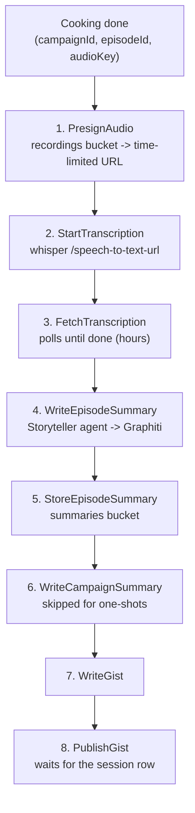

# summary-orchestrator

Turns a freshly cooked recording into a narrative summary, a knowledge-graph
entry and a short gist, without ever holding the audio itself.

It runs *alongside* video processing rather than inside it: `processing-orchestrator`
finishes encoding, uploading and handing the video back to the user while this
is still working. Summarization takes hours; publishing a video should not wait
on it.

## The workflow



Nothing here writes a prompt or calls a model directly. The
[Storyteller](https://github.com/SoTrxII/storyteller) agent owns every prompt
and persists what it writes to Graphiti; this service only decides *when* and
*in what order*.

## Two decisions worth knowing

**The audio never travels through this process.** Whisper is handed a presigned
URL and downloads the recording itself. A full session is hundreds of megabytes,
comfortably past what fits through the sidecar's gRPC channel.

**The gist waits for the rest of the pipeline.** A gist is keyed on
`(campaignId, sessionNumber)`, and that session row is only written by Velvet
once the video has finished uploading — often well after the summary is ready.
`PublishGist` looks the row up first and reports "not ready" until it exists, so
the workflow's backoff waits for the video pipeline instead of racing it, then
publishes with the number the database actually assigned rather than the one
the caller guessed.

## Retries

| Step | Policy | Why |
|---|---|---|
| Presign, store, campaign summary | 4 attempts, 5s → 1m | Ordinary blips. |
| FetchTranscription | 600 attempts, 1m → 10m, 48h cap | Measured: a 3h03m recording takes 8h28m–10h46m on this CPU, roughly 3x real time. |
| WriteEpisodeSummary | **no retry** | The agent stores what it writes in Graphiti, and Graphiti will happily accept the same episode twice. |
| PublishGist | 12 attempts, 30s → 10m, 2h cap | Waits for the video to finish uploading. |

Retry decisions cannot use `errors.Is`: an activity's error crosses the runtime
boundary as a serialized string. Failures worth waiting out are tagged with a
marker in their message instead — see `workflows/workflows-api.go`.

## API

```http
POST /workflows/episode
{ "jobId": "...", "campaignId": 14, "episodeId": 4, "isOneShot": false, "audioKey": "abc.ogg" }
```

The processing job id doubles as the workflow instance id, which makes the
endpoint idempotent: a caller that retries joins the run already in flight
instead of starting a second one.

```http
GET /workflows/{id}    # status
GET /health
```

## Configuration

| env variable | description | default |
|---|---|---|
| `APP_PORT` | HTTP port | `8080` |
| `DAPR_GRPC_PORT` | Dapr sidecar gRPC port | `50001` |
| `OBJECT_STORE_NAME` | binding holding the recordings | `object-store` |
| `SUMMARY_STORE_NAME` | binding the summaries are written to | `summaries` |
| `DB_NAME` | binding for the rpg database | `db` |
| `PUBSUB_NAME` | pub/sub component | `pubsub` |
| `GIST_TOPIC` | topic `summary-updater` listens on | `gists` |
| `PRESIGN_TTL` | lifetime of the URL handed to whisper; only needs to outlive the download, which happens inline | `6h` |
| `WHISPER_URL` | whisperX-FastAPI base url | `http://whisper:8000` |
| `WHISPER_BEARER_TOKEN` | matches the server's `AUTH__BEARER_TOKEN` | |
| `WHISPER_LANGUAGE` | passed explicitly; the API's own default is `en` regardless of the server's `DEFAULT_LANG` | `fr` |
| `WHISPER_MODEL` | optional override; empty means the server's own model | |
| `STORYTELLER_URL` | the agent, reached directly; it serves JSON-RPC on `/` | `http://storyteller:9999` |
| `STORYTELLER_VIA_GATEWAY` | reach it through the LiteLLM proxy instead. Works, but from inside the cluster it is a round trip out to the proxy and back in, since the registered agent card points at `storyteller.private:9999` | `false` |
| `GATEWAY_URL` | LiteLLM proxy, when `STORYTELLER_VIA_GATEWAY` is set | `http://ai-gateway.private:4000` |
| `GATEWAY_API_KEY` | LiteLLM key | |
| `STORYTELLER_AGENT` | agent name, resolved to the uuid LiteLLM routes on | `Storyteller` |
| `OTEL_EXPORTER_OTLP_ENDPOINT` | OTLP endpoint | |
| `SERVICE_NAME` / `SERVICE_VERSION` | telemetry identity | `summary-orchestrator` / `0.1.0` |

### Dapr components

Five, all of which already exist in the `tabletop-records` namespace. The
defaults above are those names, not Dapr's.

| Component | Type | Purpose |
|---|---|---|
| `statestore` | state.redis | Workflow durability. **Must** have `actorStateStore: true`. |
| `object-store` | bindings.aws.s3 | The recordings bucket, presigned for whisper. |
| `summaries` | bindings.aws.s3 | Where generated summaries are stored. |
| `db` | bindings.postgresql | Resolving an episode to its session number. |
| `pubsub` | pubsub.redis | Publishing gists to `summary-updater`. |

## Not done yet

- **The agent has no `gist` task.** `Tâche: gist` currently falls through to its
  default branch and returns another full chapter. Until
  [storyteller](https://github.com/SoTrxII/storyteller) grows the skill, the
  gist will be the wrong length.
- **The deployed agent cannot reach a model.** `storyteller`'s `OPENAI_API_KEY`
  is `sk-dev-master-key`, which the gateway rejects with a 401; `graphiti-mcp`
  next to it uses `master-key`, which works. Until that is fixed in gitops,
  every summarization call fails at the first model request.
- **Nothing calls this yet.** `processing-orchestrator` needs a nil-able
  `Summarizer` addon, fired at the end of `cook()` the way `ThumbGen` is fired
  during `upload()`, and its proto needs to carry `campaignId` / `episodeId` /
  `isOneShot` the way `UpdateRequest` already carries `Thumbnail`.

## Development

```bash
make test        # unit tests, with the race detector
make dapr        # run against the components in dapr/components
```
